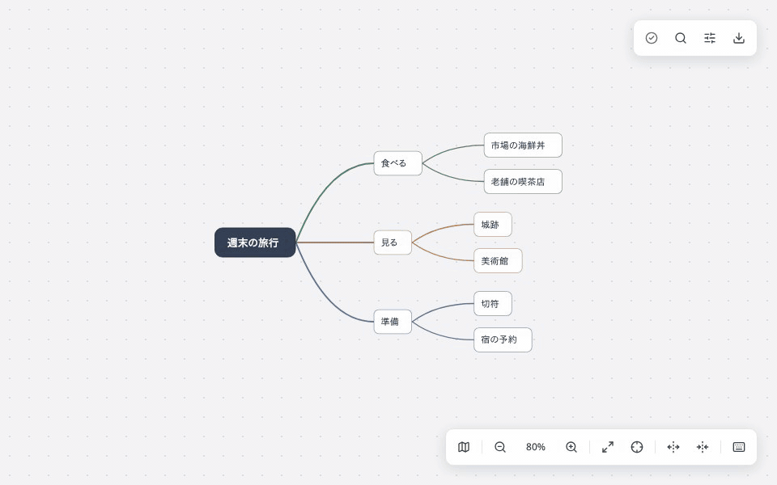

# MindFlow

**秘密は手元に、品質は妥協せず。**

VS Code 上で Markdown ドキュメントを美しく直感的なマインドマップとして可視化・編集できる VS Code 拡張機能です。アカウント不要・通信なし・オフラインで完結します。




## 主な機能

- **Markdown リアルタイム同期**: VS Code 上の `.md` ファイルと双方向で同期。キーボード操作で瞬時に思考を構造化。
- **オフラインで完結**: 通信するコードを持たず、テレメトリもありません。保存形式は素の Markdown です。
- **直感的なキーボード操作**: Tab（子ノード作成）、Enter（兄弟ノード作成）、F2 / Space（インライン編集）、Alt+↑/↓（並べ替え）など。
- **多彩なレイアウト・テーマ**: マインドマップ、左右ツリー、垂直ツリー、各種カラーテーマ、フォント切替。
- **エクスポート**: PNG、SVG形式での画像エクスポートに対応。
- **検索・クリップボード画像貼り付け**: ノード検索やスクリーンショット貼り付けに対応。

## プライバシー

優れたマインドマップツールは数多くありますが、機密のメモをクラウドに預けられない人もいます。MindFlow は、データを手元の Markdown ファイルに置いたまま使えます。

- 通信を行うコードを含まず、テレメトリもありません。フォントも同梱で、外部から読み込みません。
- Webview の CSP で、`fetch` や WebSocket などの通信を止めています。外に出られるのは、Markdown に書いた外部画像の URL を読み込むときだけです。
- ファイルは通常のテキストとして保存されます。**暗号化はしていません。** 守るのは「外に出さないこと」です。

## 開発・ビルド方法

### 必須要件
- Node.js (v18以上)
- npm

### インストール
```bash
npm install
cd vscode-extension && npm install && cd ..
```

### ビルド
```bash
# Webview と拡張機能本体の両方をビルド
npm run build
```

### テスト
```bash
npm run test
```

### VS Code 拡張機能パッケージ作成 (.vsix)
```bash
npm run package:ext
```

### VS Code での F5 デバッグ実行
1. VS Code でプロジェクトルートを開きます。
2. `F5` キーを押すと自動的にビルドが走り、「拡張機能開発ホスト（Extension Development Host）」ウィンドウが起動します。
3. 任意の `.md` ファイルを右クリックし、「プログラムから開く...」➔「MindFlow マインドマップエディタ」を選択（またはコマンドパレットから `MindFlow: マインドマップとして開く` を実行）。

### ライセンスと配布物
- ライセンスは MIT（`LICENSE`）。`vscode-extension/LICENSE` は同じ内容のコピーで、`.vsix` に入る。
- Webview に同梱される依存（react・react-dom・scheduler・lucide・lucide-react）を変えたら、`vscode-extension/THIRD_PARTY_LICENSES.md` も更新する。
- 拡張機能の説明は `vscode-extension/README.md`（英語、Marketplace の概要タブ）と `README.ja.md`。表示名・説明は `package.nls*.json`。
