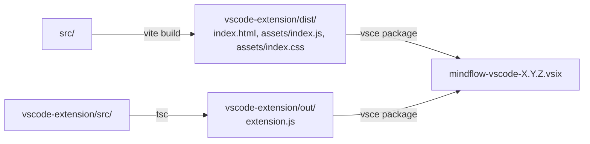

# 技術仕様書

> 本書は既存実装（v0.1.0）から起こしたものです。機能の構成は [functional-design.md](functional-design.md) を参照してください。

## 1. テクノロジースタック

### 1.1 Webview（ルート、`src/`）

| 分類 | 技術 | バージョン | 用途 |
|---|---|---|---|
| 言語 | TypeScript | ~5.8 | 全コード |
| UI | React / React DOM | ^19 | 画面描画（関数コンポーネントとフック） |
| ビルド | Vite + `@vitejs/plugin-react` | ^8 / ^6 | 開発サーバーと本番ビルド |
| スタイル | Tailwind CSS（`@tailwindcss/vite`） | ^4 | ユーティリティクラス。テーマもクラス文字列で定義する |
| アイコン | lucide-react | 1.x（固定） | UI アイコンとノードアイコン。`import * as` にせず、使うものを名前で取り込む（全部入るとバンドルが 3 倍になる） |
| アイコン（書き出し） | lucide | 1.x（固定） | 書き出す SVG のアイコン。`lucide-react` と同じ版に固定する |
| テスト | Vitest | ^5 | `src/**/*.test.ts` と `vscode-extension/src/**/*.test.ts` の単体テスト |
| E2E テスト | Playwright（Chromium） | 固定（`package.json` を参照） | `e2e/*.e2e.ts`。`npm run dev` のブラウザ単体モードを操作する |
| 描画 | SVG / HTML | — | 接続線と関連線は SVG、ノードは HTML 要素 |

> 版は、主要な版（メジャー）だけを書いています。正確な版は `package.json` が正で、Dependabot が毎月更新します（[development-guidelines.md](development-guidelines.md) の 5.5）。固定している依存（`lucide`・`lucide-react`・`@playwright/test`）は、`package.json` で版を固定しています。

### 1.2 拡張機能ホスト（`vscode-extension/`）

| 分類 | 技術 | バージョン | 用途 |
|---|---|---|---|
| 言語 | TypeScript（`strict: true`） | ^7 | CommonJS / ES2020 に変換する |
| API | VS Code Extension API（`@types/vscode`） | ^1.80 | Custom Text Editor、WorkspaceEdit、保存ダイアログ |
| パッケージ | `@vscode/vsce` | ^4 | `.vsix` の作成（`--no-dependencies`） |

拡張機能ホストは、外部の実行時ライブラリを使いません。Node 標準の `fs` / `path` と、VS Code API だけで動きます。

## 2. ビルドと構成



- **2 つのパッケージ**：ルートと `vscode-extension/` は、それぞれ別の `package.json` と `node_modules` を持ちます。ルートの `npm run build` が両方をまとめてビルドします
- **出力ファイル名は固定**：Vite は `base: './'` で、ハッシュなしの `assets/index.js` / `assets/index.css` を出力します。拡張機能ホストはこのファイル名を前提に、パスを `webview.asWebviewUri` に書き換えます。`dist/index.html` が読めないときのフォールバック HTML も、同じファイル名を参照しています
- **パスの別名**：`@/` は `src/` を指します（`vite.config.ts` と `tsconfig.json`）
- **生成物**：`vscode-extension/dist/`、`vscode-extension/out/`、`*.vsix` は Git で管理しません

## 3. 開発ツールと手法

| 目的 | 方法 |
|---|---|
| UI の開発 | `npm run dev` で、Webview をブラウザ単体で動かす。データは localStorage に保存する |
| 拡張機能のデバッグ | VS Code で `F5`（`.vscode/launch.json`）。ビルドタスク `build:all` を実行してから、拡張機能開発ホストを起動する |
| 型チェックと静的解析 | `npm run lint`（`tsc --noEmit` と ESLint。Webview の `src/` と、拡張機能ホストの `vscode-extension/src/` の両方）。Prettier は入れていない |
| テスト | `npm run test`（Vitest）。対象は、DOM に依存しない純粋関数（`markdownSync`、`treeOperations`、`layout` など） |
| E2E テスト | `npm run e2e`（Playwright）。キー操作・日本語入力・Undo・ドラッグ・保存と復元・文字のはみ出し・PNG 書き出しを、実際のブラウザで確かめる。初回は `npx playwright install chromium` が要る。ブラウザを先に入れてある環境では、`E2E_CHROMIUM_PATH` で Chromium を指定する |
| CI | GitHub Actions（`.github/workflows/ci.yml`）。`main` への push と PR で、Node 22 を使い lint → test → build を実行する。E2E は PR のときだけ、Playwright 公式イメージ（ブラウザとフォント入り。タグは `@playwright/test` の版に合わせる）の中で実行する |
| 作業管理 | GitHub Flow |

## 4. 技術的制約と要件

### 4.1 VS Code Webview の制約
- **Content Security Policy**：拡張機能ホストが CSP を差し込みます。

  ```
  default-src 'none';
  img-src   <webview> https: data: blob:;
  font-src  <webview> data:;
  style-src 'unsafe-inline' <webview>;
  script-src <webview>;
  ```

  組み立ては `vscode-extension/src/webviewCsp.ts` の `buildWebviewCsp` です。`script-src` に `'unsafe-eval'` は入れません（ビルドした Webview は `eval` を使いません）。`style-src` の `'unsafe-inline'` は、座標や枝の色を React の `style` 属性で指定しているためです。
  スクリプトは、拡張機能に同梱したものしか読み込めません。フォントは、同梱フォントを data URI で登録するために `font-src data:` を使います（`connect-src` はないので、Webview から `fetch` はできません）。画像は、外部の https の URL（Markdown の ``）と Data URL（貼り付けた画像）を許可しています
- **読み込めるファイルの範囲**：`localResourceRoots` は `vscode-extension/dist/` だけです
- **非表示中も状態を保つ**：`retainContextWhenHidden: true` を指定しています。タブを切り替えても、Webview の状態は消えません
- **ファイルに直接アクセスできない**：Webview からのファイル操作（保存、エクスポート、リンクを開く）は、すべてメッセージで拡張機能ホストに頼みます
- **Undo/Redo**：Webview 側の自前の履歴を使います（`useUndoableMap`、マップ全体のスナップショット、メモリ上・セッション内のみ、上限 100）。`Ctrl/Cmd + Z / Y` は Webview が処理し、keydown の伝播を止めて VS Code 側の TextDocument の Undo が走らないようにします。テキストエディタでの編集など外部からの `update` を受け取ると、履歴は作り直されます

### 4.1.1 画面の言語
- **決め方**：設定 `mindflow.language`（`auto` / `ja` / `en`、既定は `auto`）と、VS Code の表示言語（`vscode.env.language`）から、拡張ホストの `resolveLocale()` が `ja` か `en` に決めます。`auto` は、表示言語が日本語なら `ja`、それ以外は `en` です
- **Webview への伝え方**：ホストが `webview.html` の `<html>` に `lang` と `data-mindflow-locale` を入れます。Webview の `getLocale()` はその値を読み、なければ `navigator.language` で決めます（ブラウザ単体の開発モード）。言語は最初の呼び出しで決まり、実行中には変わりません
- **設定を変えたとき**：ホストが `onDidChangeConfiguration` で `webview.html` を入れ直します。内容はドキュメントにあり、`ready` → `init` で届くため、編集中の内容は失われません
- **ホストの文字列**：通知・保存ダイアログは `vscode-extension/src/messages.ts` の小さな辞書で出します。`vscode.l10n` は VS Code の表示言語にしか従わず、設定の上書きと食い違うため使いません。`package.json` の表示名は `package.nls.json`（英語）と `package.nls.ja.json` です

### 4.2 データ形式の制約
- 保存形式は Markdown テキストだけです。マップの状態は、すべて `.md` の中で表せる必要があります
- ノードに項目を追加するときは、`markdownSync.ts` の書き出しと読み込みの両方に対応させます。片方だけだと、保存したときにその項目が消えます
- 画像は Base64 の Data URL のまま `.md` に埋め込むので、画像を多く添付するとファイルが大きくなります
- 保存のたびに、ドキュメント全体を書き換えます（差分だけを書き込むことはしません）

### 4.3 ネットワーク
- データの保存や同期に、ネットワーク通信は使いません
- フォントも取りに行きません。マップの欧文フォント（Noto Sans / Noto Serif / Noto Sans Mono の latin サブセット、500・700）は Webview に同梱し、和文は OS のフォントで描きます（詳しくは 4.4）
- ノードの画像に外部 URL を指定した場合は、その画像を取りに行きます

### 4.4 フォント
- **書体**は `src/utils/fontStyles.ts` の `FONT_STYLES`（ゴシック `sans`・明朝体 `serif`・等幅 `mono`）。CSS の `font-family` は `buildFontFamilyCss` だけが組み立て、画面・フォント選択パネル・書き出しが使います。並びは「同梱の欧文フォント → 和文フォント（Mac → Windows → Linux の名前）→ 総称」です。和文を名前で指定するので、`<html lang>` が `en` でも中国語の字形になりません
- **同梱フォント**は、Fontsource の配布ファイル（woff2）を Vite の `?inline` で data URI として JS に取り込み（`src/utils/fontFaces.ts`）、起動時に `FontFace` で登録します（`src/services/fontLoader.ts`）。登録だけで `load()` は呼ばず、読み込み・デコードは、ブラウザがその書体・太さ・斜体の文字を描くときに行います（使わない書体や字形は読み込まれません）。名前は `Mindflow Sans` などの専用名で、利用者の PC に入っている別の版と混ざりません。ファイルとして出さないので、Vite の出力ファイル名は変わりません
- **書き出し**（SVG・PNG）は、同じ data URI を `@font-face` で SVG に埋め込みます。PNG は SVG を `` に読み込んで描くため、ページのフォントは使えず、埋め込みが必要です。使っている太さ・字形の分だけ埋め込みます
- **文字幅の見積もり**は、テキストごとに字幅の表を 1 回引いて（`getLatinWidthTable`）、1 文字ごとに「字幅の表の幅」と「それを整数 px に丸めた幅」の大きいほうを取ります。ヒンティングが効く環境（Linux など）は、字送りを 1 文字ごとに整数 px へ丸めて描くため、丸めなしの幅より広くなるからです。サブピクセル配置の環境では、平均 0.1px/字ほど大きめになります
- **`‥` `…`** は、日本語の文中で和文の字形にしたいので、同梱フォントの `unicode-range` から外しています（`CJK_PREFERRED_CODE_POINTS`）
- **ライセンス**は SIL OFL 1.1 で、Reserved Font Name のない書体を選んでいます（`vscode-extension/THIRD_PARTY_LICENSES.md`）。Source 系は Reserved Font Name「Source」があり、収録文字を絞ったファイルを再配布できないため使いません

## 5. パフォーマンス要件

| 項目 | 要件・現状 |
|---|---|
| 自動保存 | 変更を 150ms 待ってからまとめて保存する。内容が前回と同じなら送らない |
| レイアウト計算 | `mindMap` が変わるたびに、マップ全体を計算し直す（`useMemo`）。ノードの大きさはテキストから推定するので、DOM の計測は待たない |
| 描画 | 折りたたんだ枝は描かない。コンポーネントのメモ化（`React.memo`）は、現状では使っていない |
| 規模の目安 | 数百ノードで操作に遅延を感じないこと（目標値は product-requirements.md で要確認） |
| 画像 | 画像を含むマップでも、ドラッグ・ズーム・パンが快適に動くこと |

## 6. 既知の技術的課題

現在、既知の課題はありません。
