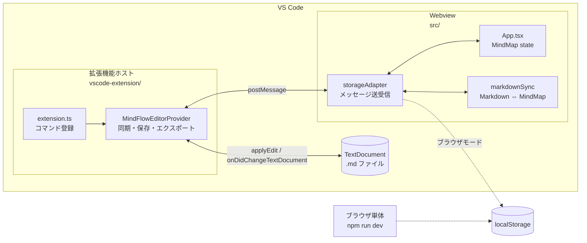
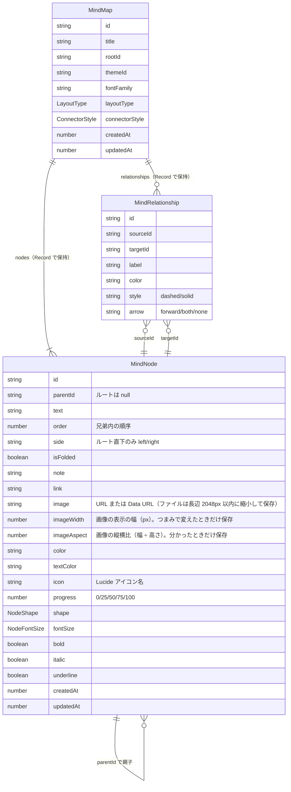
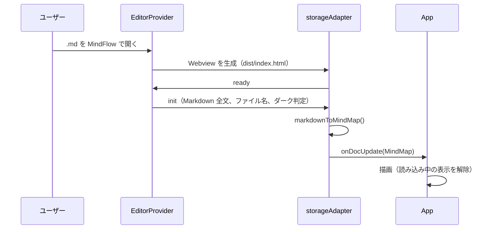
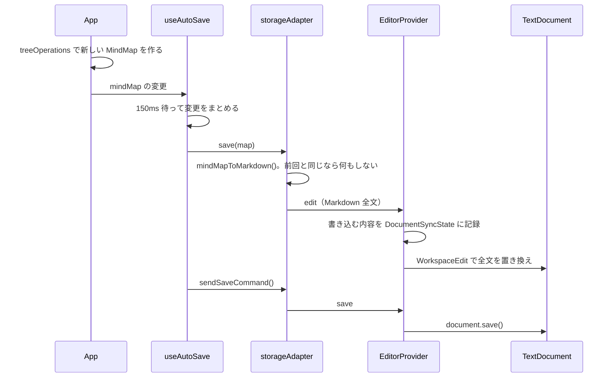
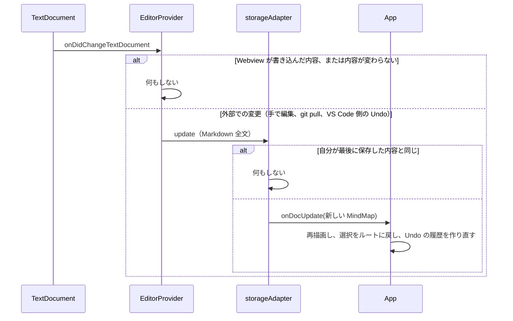
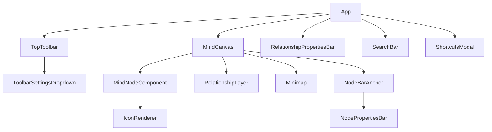
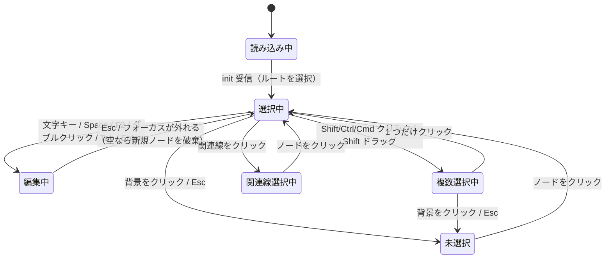
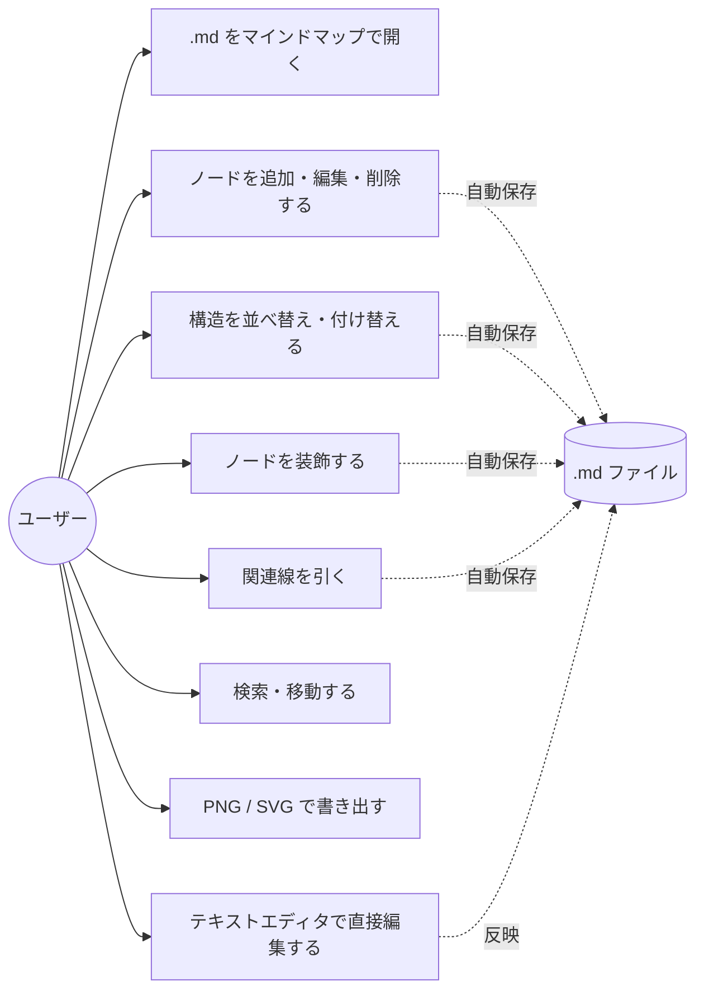

# 機能設計書

> 本書は既存実装（v0.1.0）から起こしたものです。要求は [product-requirements.md](product-requirements.md) を参照してください。

## 1. システム構成

MindFlow は、VS Code の **Custom Text Editor** として動作します。拡張機能ホストと Webview の 2 つのプロセスに分かれ、`postMessage` でやりとりします。開発時は、Webview をブラウザ単体でも動かせます。



| 層 | 役割 | 主なファイル |
|---|---|---|
| 拡張機能ホスト | `.md` を開いたときに Webview を作る（エディタは `mindflow.markdownEditor` の 1 つ。普通の `.md` は Open With で開き、専用拡張子 `*.mindflow.md` は `configurationDefaults` の `workbench.editorAssociations` で既定にしているのでクリックで開く）。新規マインドマップの作成（`mindflow.createNewMap`。`Untitled-N.mindflow.md` と自動で名付け、初期内容は `# 名前` の 1 行）。ドキュメントの書き換えと保存、テーマ変更の通知、外部リンクを開く、エクスポート時の保存ダイアログ | `vscode-extension/src/extension.ts`、`mindFlowEditorProvider.ts`、`newMapFile.ts` |
| 通信・永続化 | 動作モード（VS Code／ブラウザ）の判定、メッセージ送受信、Markdown 変換の呼び出し | `src/services/storageAdapter.ts` |
| 変換 | Markdown と `MindMap` の相互変換 | `src/utils/markdownSync.ts` |
| 状態・操作 | `MindMap` state の保持、ツリー操作、選択状態、自動保存 | `src/App.tsx`、`src/utils/treeOperations.ts`（実装は `src/utils/tree/`）、`src/hooks/` |
| 描画 | レイアウト計算、キャンバス、ノード、関連線、ツールバー | `src/utils/layout.ts`、`src/utils/nodeDimensions.ts`、`src/utils/connectionPath.ts`、`src/components/` |

## 2. データモデル

### 2.1 ER 図



型定義は `src/types.ts` にあります。

### 2.2 設計上の決まり
- ノードは入れ子にせず、`Record<id, MindNode>` のフラットな形で持ちます。親子関係は `parentId`、兄弟の順序は `order` で表します
- ツリー操作は `treeOperations.ts` の純粋関数で行います。どれも元の `MindMap` を書き換えず、新しい `MindMap` を返します
- ノードを削除すると、子孫ノードと、それらにつながる関連線もあわせて削除します
- ルートノードは削除できません

### 2.3 Markdown での保存形式

```markdown
---
title: "中心トピック"
layoutType: mindmap
themeId: oceanic
connectorStyle: arc   # arc（既定）/ curved / rounded / straight。書いていない値・知らない値は arc として開く
fontFamily: sans      # sans（既定）/ serif / mono（大文字小文字・前後の空白は区別しない）。rounded・handwriting・知らない値は sans として開く（値は書き換えない）
updatedAt: 2026-10-01T00:00:00.000Z
---

# 中心トピック
<!-- mindflow-meta:{"id":"root","note":"..."} -->

- 子ノード A <!-- mindflow:{"id":"node_x","color":"#3b82f6","icon":"Star"} -->
  - [x] 完了した孫ノード
  - [ ] 進行中の孫ノード (50%)
- 子ノード B

<!-- mindflow-relations:[{"id":"rel_1","sourceId":"node_x","targetId":"node_y","label":"依存"}] -->
```

| Markdown の要素 | 対応するデータ |
|---|---|
| YAML フロントマター | `MindMap` の設定項目 |
| `# 見出し` | ルートノードの `text` |
| 見出し直後の `<!-- mindflow-meta:{...} -->` | ルートノードの属性 |
| `- ` 箇条書き（2 スペースごとに 1 階層） | 子ノード。並び順が `order` になる |
| `[x]` / `[ ] ... (N%)` | `progress` |
| 行末の `<!-- mindflow:{...} -->` | そのノードの属性（`NodeMetadata`） |
| `<!-- mindflow-relations:[...] -->` | 関連線の一覧 |

属性を持たないノードには、HTML コメントを付けません。読み込むときは、存在しないノードを指す関連線を捨てます。

## 3. 主要な処理の流れ

### 3.1 ファイルを開く



### 3.2 マインドマップでの編集を保存する



ファイルへの書き込みは VS Code の `WorkspaceEdit` を通します。そのため、未保存の印は VS Code 本体の仕組みがそのまま働きます。

Undo/Redo は Webview 側で処理します（`Ctrl/Cmd + Z / Y`、`useUndoableMap`）。履歴はマップ全体のスナップショットで、メモリ上・セッション内だけに持ち、上限は 100 です。Undo の結果も、ほかの編集と同じく `edit` として書き込まれます。Webview が `Ctrl/Cmd + Z / Y` の keydown の伝播を止めるので、VS Code 側の TextDocument の Undo は走りません。

### 3.3 テキストエディタでの変更を反映する



自分の保存が戻ってきて再描画が繰り返されるのを、両側で防いでいます。拡張機能ホスト側は、時間ではなく内容で判定し（`DocumentSyncState`）、`edit` は 1 つずつ順番に書き込みます。保存時の自動整形などで内容が変わった場合は、外部の変更として Webview に送ります。Webview 側は `lastSavedMarkdown` で判定します。

## 4. コンポーネント設計



| コンポーネント | 役割 |
|---|---|
| `App` | `MindMap` state、選択状態、編集状態、キーボードショートカット、画像の貼り付け、トースト表示を管理する。子コンポーネントには操作用のコールバックを渡す |
| `TopToolbar` / `ToolbarSettingsDropdown` | 右上に浮く塊（`FloatingBar`）。保存状態（アイコン。エラーのときだけ文字も出す）の表示。テーマ、フォント、レイアウト、接続線、入力モード、右クリックでのパンの切り替え。検索、エクスポート、手動保存。保存状態は `SaveStatusBadge`、画像保存メニューは `ToolbarExportMenu`、設定メニューの各項目の中身は `ToolbarSettingsPanels`、共通の見た目は `ToolbarParts`、選択肢に添える見本の絵（テーマ・接続線・形）は `SettingsPreviews` に分けている |
| `MindCanvas` | ズーム・パン、範囲選択、ドラッグ＆ドロップ、全体表示。ノードと接続線を描く。放射状のマップでは、ノードをルートの左半分に落とすと左側、右半分に落とすと右側の末尾に入る（`computeRootDropSide`、ドラッグ中は `NodeDropIndicator` が縁に線と札を出す） |
| `MindNodeComponent` | 1 ノードの表示とインライン編集。画像ファイルのドロップを受け付ける |
| `NodeImage` | ノード内の画像を縦横比のまま全体で出す。1 ノードだけ選んでいるときは、角のつまみで表示の幅を変えられる（大きさは `utils/imageBox.ts` の `resolveImageBox` が決める） |
| `NodeNotePopover` | メモの印に乗せたときに出る、メモの全文の表示。位置は `utils/notePopoverPosition.ts` が決める |
| `RelationshipLayer` | 関連線を SVG で描き、クリックで選択できるようにする |
| `Minimap` | マップ全体の縮小表示。右下のビューバーの「ミニマップ」ボタンで開閉する。座標の計算は `utils/minimapGeometry.ts` が受け持つ |
| `NodeBarAnchor` | ノードのプロパティバーを、選択中のノード（複数選択なら最後に選んだノード）の上に、左端を揃えて置く。パン・ズームに付いていき、大きさはズームで変えない。画面の上端・左右の端では内側で止め、ノードが画面の外にあれば隠す（位置は `computeNodeBarPosition`）。バー上の操作は、キャンバスの選択解除・パン・ズームに伝えない |
| `RelationshipPropertiesBar` | 関連線を選んだときの、画面下部のプロパティバー |
| `NodePropertiesBar` | ノードのプロパティバー（置き場所は `NodeBarAnchor`）。選択中のノード（複数可）の属性を編集する。1 ノード選択のときはノード名を出さない。複数選択のときは、件数・関連線の作成・削除のボタンを出し、メモ・リンク・画像は出さない（ノードごとの内容なので）。上段は、文字・色・アイコン・形・進捗・メモ・リンク・画像のボタンで、押すと上段の上にパネルが開く（上段のボタンは動かない）。選ぶ項目はすぐ反映し、メモ・リンク・画像の URL は入力欄から離れたときと Enter で反映する。文字サイズ・太字・斜体・下線・文字色は「文字」（`NodeTextPanel`）。兄弟の並べ替えは `Alt + ↑ / ↓` とドラッグ、枝の左右はドラッグで行う（バーにボタンはない） |
| `SearchBar` | マップ内のテキスト検索 |
| `ShortcutsModal` | ショートカット一覧（キーは 1 つずつ `kbd`、広い幅で 2 列、`role="dialog"`、フォーカストラップ、Esc・背景のクリックで閉じる） |

| フック | 役割 |
|---|---|
| `useMindMapSelection` | 選択中のノード（複数可）、編集中のノード、コピー元のノード、選択履歴を管理する |
| `useAutoSave` | 変更を 150ms 待ってまとめて保存し、保存状態を管理する。手動保存も扱う |

### 4.1 レイアウト計算
`calculateLayout(map)` は `mindMap` が変わるたびに計算し直します（`useMemo`）。

- ルートを原点 (0, 0) に置く
- `tree-right` / `tree-left` では、ルート直下の子をすべて片側に並べる。`mindmap` では、子の `side` に従って振り分ける。指定がない子は、並び順に「右を先に 5 本、次に左を 5 本、そのあとは右・左の交互」で置く（`rootSide.ts` の `nextRootChildSide` / `assignRootChildSides`。読み込み・描画・追加が同じ決まりを使う）
- ノードの大きさは、DOM で実測せずテキストから推定する（`nodeDimensions.ts` の `estimateNodeDimensions`）。画像があれば、画像の枠の大きさ（`resolveImageBox`）の分を加える。縦横比が分からない画像は、決まった大きさの枠に全体を出す
- 枝の色は、ルート直下の子ごとにテーマの `branchColors` から割り当てる。ノードに `color` があれば、それを優先する
- 折りたたんだノードの子孫は描かない

#### ルートの子を足す側（`mindmap`）
新しい子の側は、右の数 R・左の数 L として「R < max(5, L + 1) なら右、そうでなければ左」で決める（最初の 5 本は右に置き、そのあと左へ回す）。付いた子には `side` を保存するので、手で動かした左右は崩れない。

| 操作 | 置き方 |
|---|---|
| ルートで Tab | 決まりに従う。その側の末尾に入る |
| ルートの子で Enter、基準がその側の末尾 | 決まりに従う。基準と同じ側なら基準のすぐ後ろ、反対側なら並び全体の末尾 |
| ルートの子で Enter、基準が途中 / Shift+Enter | 基準と同じ側の、すぐ後ろ / すぐ前 |
| 左右の＋ボタン、ドラッグ&ドロップ、貼り付け | ユーザーが選んだ側 |
| 孫より深い階層 | 親と同じ側 |

### テーマ

- テーマ（`ThemeConfig`、`themes.ts`）は 4 つ（`natural` / `oceanic` / `minimal` / `darkAurora`）。背景、通常のノード、線、枝の色（8 色）、状態色（`accent` / `onAccent`。枝の色・ルートの面と離れた色にする。モノクロだけ例外）、完了の色（`done`）、ルートノードの色（`root.bg` / `text` / `border`、いずれも 16 進の色）を持つ
- ルートノードは単色で塗る。画面では CSS 変数（`--mf-root` など）経由の `bg-root` / `text-on-root` / `border-root-line`、書き出しでは同じ値を SVG の属性として使うので、画面と書き出しで色が変わらない。ルートに `color` があればそれを優先する
- 通常のノードの色（`ThemeConfig.node`）も 16 進で持ち、ルートと同じ方法（CSS 変数の `bg-node` / `text-on-node` / `border-node-line`、書き出しは SVG の属性）で使う。形・色・文字の決まりは `nodeStyle.ts` の `getNodeShapeSpec` / `getNodeColors` / `getNodeFontSpec` に集め、書き出しはそこから取る。枠は、ルートが 1px の四辺（`border-root-line`、色を指定したら指定色、ホバーで `border-on-root/60`）、角丸・ピルが 1px の四辺で枝の色（`branchColor`、色を指定したノードは指定色）の 60%・ホバーで 100%（枝の色がないときだけテーマの `border-node-line`）、`underline` が下辺の線（指定色か枝色）、`borderless` はなし。左のアクセントバーは持たない（枝の色は枠・下線・アイコン・折りたたみの印・接続線で表す）。書き出しも同じ枠を矩形の内側に描き、中身を枠の幅だけ内側にずらす。階層 1 も枠は同じ（区別しない）。接続線の太さは `connectionPath.ts` の `CONNECTION_WIDTH`（ルートから出る枝 2.5px、それ以外 1.6px）を画面と書き出しで共有する
- 書体はマップ全体で 1 つ（`MindMap.fontFamily`、`fontStyles.ts` の `resolveFontStyle` で決める）。ゴシック・明朝体・等幅の 3 種類で、欧文は同梱フォント、和文は OS のフォントで描く。なくした書体（丸ゴシック `rounded`・手書き風 `handwriting`）と知らない値はゴシックとして描き・見積もり・書き出すが、ファイルの値は利用者が選び直すまで書き換えない
- UI（ツールバー・メニュー・パネル）の灰色は、`ThemeConfig.ui`（面 4・枠 3・文字 3 の 10 色）で持つ。`themeCssVariables(theme)` が `--mf-*` の CSS 変数にし、`index.css` の `@theme inline` で `bg-surface`・`border-line`・`text-ink` などのクラスになる。ナチュラルは stone、オーシャン・ダークは slate、モノクロは neutral の灰色で、ダークも同じクラスのまま値が替わる（`dark:` の対は書かない）
- 接続線は、親の子がある側の辺の中央から、子の親に近い側の辺の中央へ引く。ただし `underline` のノードは、辺の中央ではなく下線の高さ（`getAnchorY`）につなぐ。折りたたみの印・子の追加ボタンも同じ高さの、辺の外に置く
- 折りたたみの印（`getFoldMarker`）：閉じているノードは、隠れている子の数を枝色の丸（桁が増えると横に伸びる）で常に出す。開いているノードは、ホバーか選択のときだけ小さな「−」を出す。書き出しには、閉じているときの数の印だけを描く
- 表示に使うテーマは `getTheme(themeId)` で取る。なくしたテーマの ID（`naturalSage` / `emerald` → `natural`、`sunset` / `lavender` → `oceanic`、`immersive` → `darkAurora`）は読み替え、知らない ID は `natural` にする。読み替えは表示のときだけで、Markdown の `themeId` は書き換えない

## 5. 画面設計

### 5.1 画面構成

```
┌──────────────────────────────────────────────────────────┐
│                          TopToolbar（浮く）保存 検索 設定 出力 │
│                                          ┌─ SearchBar ─┐ │
│                                          └─────────────┘ │
│              MindCanvas                                   │
│        ┌────┐                                             │
│        │ 子 ├──┐      ┌──────────┐      ┌────┐            │
│        └────┘  ├──────┤ ルート   ├──────┤ 子 │            │
│        ┌────┐  │      └──────────┘      └────┘            │
│        │ 子 ├──┘           ┊ 関連線（点線）                │
│        └────┘                                ┌─────────┐ │
│                                              │ Minimap │ │
│                                              └─────────┘ │
├──────────────────────────────────────────────────────────┤
│ RelationshipPropertiesBar（関連線の選択時のみ表示）        │
└──────────────────────────────────────────────────────────┘
```

画面は 1 枚だけで、画面遷移はありません。検索バー、ショートカット一覧、プロパティバーは、必要なときに重ねて表示します（ノードのプロパティバーは、選択中のノードの上に出ます）。

### 5.2 操作状態の移り変わり



## 6. ユースケース



## 7. メッセージ仕様（Webview ⇔ 拡張機能ホスト）

バックエンドの API はありません。かわりに、Webview と拡張機能ホストの間で次のメッセージをやりとりします。

### 7.1 Webview → 拡張機能ホスト

| type | データ | 処理 |
|---|---|---|
| `ready` | なし | 初期化が済んだことを知らせる。ホストは `init` を返す |
| `edit` | `text`：Markdown 全文 | 内容が違えば、ドキュメント全体を `WorkspaceEdit` で置き換える |
| `save` | なし | `document.save()` を呼ぶ |
| `exportFile` | `defaultName`、`data`、`format`（`png`／`svg`） | 保存ダイアログを出し、選ばれた場所に書き込む。PNG は Data URL を復元してから書き込む |
| `openUrl` | `url` | `vscode.env.openExternal` で開く |
| `alert` | `message` | VS Code の情報メッセージとして表示する |

### 7.2 拡張機能ホスト → Webview

| type | データ | 処理 |
|---|---|---|
| `init` | `text`、`uri`、`fileName`、`isDark` | Markdown を読み込み、最初の描画をする |
| `update` | `text`、`fileName` | 外部での変更を反映する。自分が最後に保存した内容と同じなら何もしない |

## 8. エクスポート

- `utils/exportUtils.ts` の `generateSvgMarkup` が、レイアウト結果から SVG を組み立てる。添付した画像も `<image>` 要素として入れる
- ノードは画面と同じ中身を描く。アイコン、進捗バッジ（100% だけ `done`、それ以外は文字色の薄い面。色は `mixHex` で画面の割合に合わせる）、メモとリンクの印（文字色の 60%）、文字（ルート以外は左寄せ）。位置は `nodeDimensions.ts` の幅の見積もりと同じ寸法（`getShapePadding`・`NODE_ROW`）から決める
- アイコンの形は `utils/exportIcons.ts` が持つ。画面の `lucide-react` と同じ版の `lucide`（React を使わない版）から、ノードに付けられる 20 個と Tag・チェック印・メモ・リンクだけを名前で取り込む。ノードに付けられるアイコンを足したときは、ここにも足す（`exportIcons.test.ts` が足し忘れを検出する）
- `services/exportService.ts` が、SVG の保存と、PNG への変換（SVG を Canvas に描いてから Data URL にする）を行う
- VS Code 上では `exportFile` メッセージで保存ダイアログを出す。ブラウザでは、そのままダウンロードする

## 9. 個人設定

マップ本体（`.md`）とは別に、次の項目を Webview の localStorage に保存します。

| キー | 内容 | 初期値 |
|---|---|---|
| `mindflow_input_mode_v1` | 文字キーで編集を始めたときに、上書きするか追記するか | 上書き |
| `mindflow_right_click_pan_v1` | 右クリックドラッグでキャンバスを動かすか | 有効 |
| `mindflow_current_doc_md_v1` | ブラウザモードで最後に開いていた Markdown | なし |
