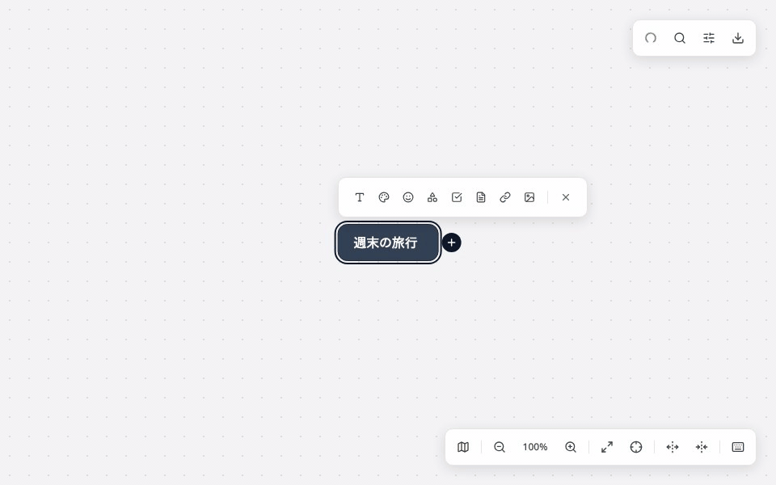
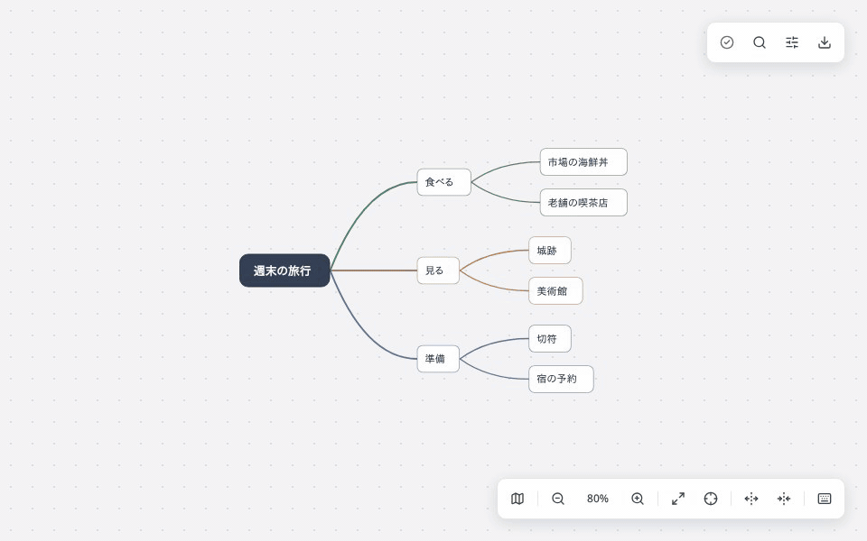

# MindFlow - Markdown マインドマップエディタ

[English](README.md) | 日本語

**秘密は手元に、品質は妥協せず。**

VS Code で Markdown ファイルをマインドマップとして編集できます。マップの変更は `.md` ファイルに書き戻され、テキストを書き換えるとマップも描き直されます。アカウントもサーバーも通信も要らず、オフラインで完結します。

優れたマインドマップツールは数多くあります。でも、機密のメモをクラウドに預けられない人もいます。MindFlow は、データを手元の Markdown ファイルに置いたまま、見た目にも操作にも妥協しないマインドマップを使うための拡張機能です。

## 特徴

- **双方向同期**: マップと Markdown テキストがいつも一致します。未保存の印は、ふつうの VS Code のエディタと同じです。元に戻す・やり直す（Ctrl/Cmd+Z / Y、100 回まで）はマップの中で動き、エディタを開いている間だけ履歴を持ちます。テキストを別のところで編集すると、履歴は作り直されます。
- **保存形式はふつうの Markdown**: `# 見出し` の下に入れ子の箇条書きです。ほかのプレビューや GitHub でも読めます。
- **オフラインで完結**: 通信するコードを持たず、テレメトリもありません。アカウントも要りません。
- **キーボード中心**: `Tab` で子ノード、`Enter` で兄弟ノード、`F2` か `Space` で編集、`Alt+↑/↓` で並べ替え。`?` で全ショートカットを表示します。
- **構造の編集**: ドラッグ＆ドロップ、複数選択、折りたたみ、コピー＆貼り付け、検索、ミニマップ、最大 400% のズーム。
- **ノードの表現**: タスクの進捗、メモ、画像（貼り付け・添付）、ノード同士をつなぐ関連線。
- **見た目**: 3 つのレイアウト（右・左・両側に展開）、4 つのテーマ（ナチュラル・オーシャン・ダーク・モノクロ）、4 つの接続線、フォントの切り替え。
- **書き出し**: PNG・SVG で保存できます。
- **日本語と英語**の画面。

## プライバシー

MindFlow は、あなたのデータを外に送りません。

- 通信を行うコードを含んでいません。テレメトリ（利用状況の収集）もありません。
- エディタの画面には厳しいセキュリティポリシー（CSP）をかけています。`fetch` や WebSocket のようなスクリプトからの通信は止められ、外に出られるのは、Markdown に書いた URL の画像を読み込むときだけです。
- フォントは拡張機能に同梱していて、外部から読み込みません。

注意点が 2 つあります。

- Markdown に外部画像の URL（``）を書いた場合は、その画像を表示するために取得します。
- ファイルは通常のテキストとして手元に保存されます。**暗号化はしていません。** 守るのは「外に出さないこと」で、ディスク上の保護ではありません。

## 使い方

**新しく作る**：コマンドパレットで **MindFlow: 新規マインドマップを作成** を実行し（エクスプローラーでフォルダを右クリックしても実行できます）。`Untitled-1.mindflow.md`（続けて `Untitled-2`、…）がすぐ作られ、マインドマップで開きます。名前は、エクスプローラーでいつでも変えられます。`.mindflow.md` で終わるファイルは、クリックするといつもマインドマップで開きます。中身は普通の Markdown のままです。

**既存の Markdown を開く**：タブかファイルを右クリックして **プログラムから開く...** → **MindFlow マインドマップエディタ** を選ぶか、コマンドパレットの **MindFlow: マインドマップとして開く** を実行します。普通の `.md` は、今まで通りテキストエディタで開きます。

`# 見出し` がルートノード、入れ子の `- `（2 スペースのインデント）が子ノードになります。色や画像など Markdown で書けない設定は、各行末の HTML コメント（`<!-- mindflow:{...} -->`）に保存されます。

## 設定

| 設定 | 値 | 既定 |
|---|---|---|
| `mindflow.language` | `auto`、`ja`、`en` | `auto`（VS Code の表示言語に合わせる） |

## ライセンス

[MIT](LICENSE)。サードパーティのライセンス表示は [THIRD_PARTY_LICENSES.md](THIRD_PARTY_LICENSES.md) にあります。

不具合・ご意見: <https://github.com/milkmanlab/mindflow/issues>
