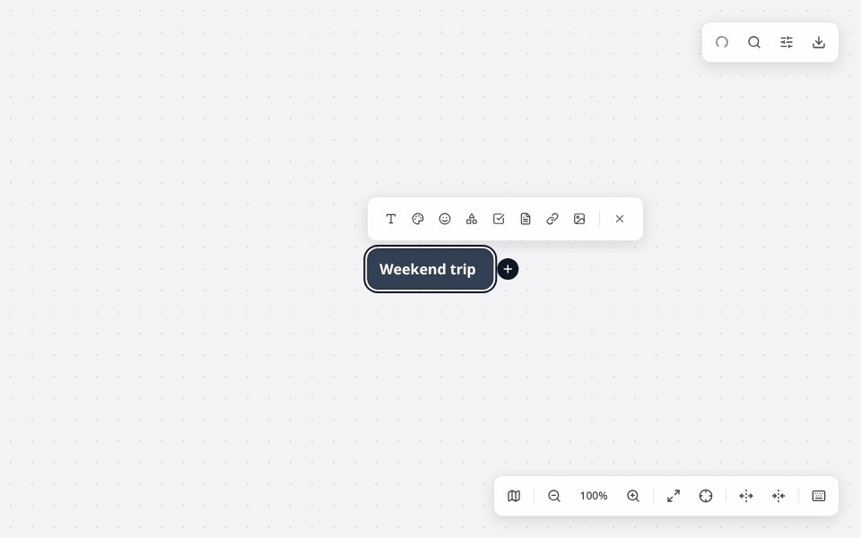
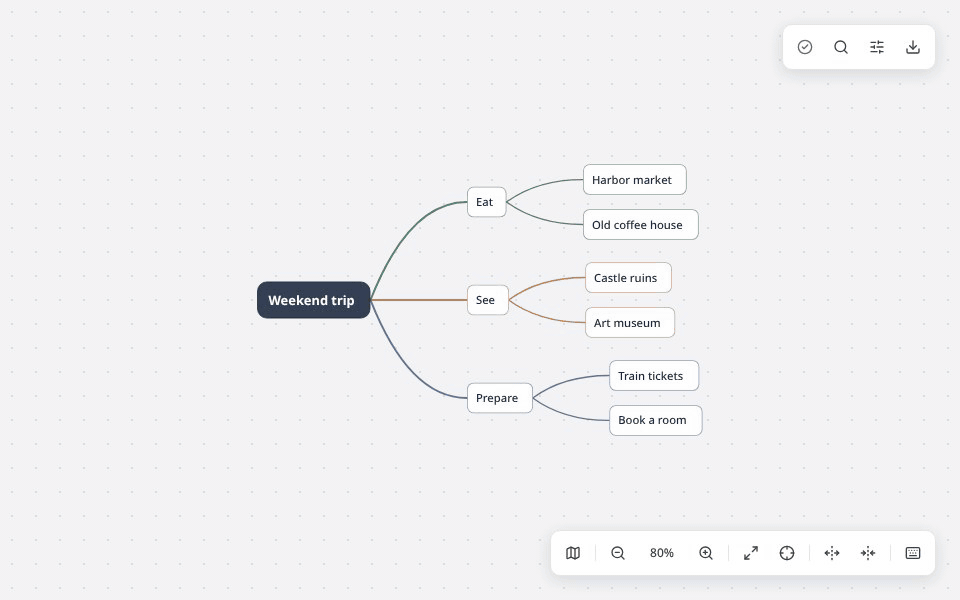

# MindFlow - Markdown Mind Map Editor

English | [日本語](https://github.com/milkmanlab/mindflow/blob/main/README.md)

**Keep your secrets close. Don't compromise on quality.**

Edit your Markdown files as mind maps in VS Code. Every change is written back to the `.md` file, and every edit to the text redraws the map. No account, no server, no network: fully offline.

There are plenty of excellent mind map tools. But not every note can be sent to the cloud. MindFlow keeps your data in a plain Markdown file on your own machine, and still gives you a mind map editor that is a pleasure to use.

## Features

- **Two-way sync**: the map and the Markdown text always match. The unsaved dot works as in any VS Code editor. Undo/redo (Ctrl/Cmd+Z / Y, up to 100 steps) works inside the map while the editor is open; editing the text elsewhere starts a fresh history.
- **Plain Markdown on disk**: a nested bullet list under a `# Title`. Files still read well in any preview or on GitHub.
- **Fully offline**: no network code, no telemetry, no account.
- **Keyboard first**: `Tab` adds a child, `Enter` adds a sibling, `F2` or `Space` edits, `Alt+↑/↓` reorders. Press `?` for all shortcuts.
- **Structure tools**: drag and drop, multi-select, collapse, copy and paste, search, minimap, zoom up to 400%.
- **Rich nodes**: task progress, notes, images (paste or attach), and relationship arrows between nodes.
- **Looks**: three layouts (expand right, left, or both sides), four themes (Natural, Ocean, Dark, Monochrome), four connector styles, font choice.
- **Export**: save the map as PNG or SVG.
- **English and Japanese** UI.

## Privacy

MindFlow does not send your data anywhere.

- The extension contains no code that talks to a server, and no telemetry.
- The editor view runs under a strict Content Security Policy. Script connections such as `fetch` and WebSocket are blocked; the only thing allowed out is loading images from URLs you write into your Markdown.
- Fonts are bundled with the extension, not loaded from the web.

Two things to know:

- If you write an external image URL in your Markdown (``), that image is fetched so it can be shown.
- Files are saved as ordinary text on your disk. **They are not encrypted.** MindFlow keeps your notes from leaving your machine; it does not protect them on disk.

## Usage

**Start a new map**: run **MindFlow: Create New Mind Map** from the Command Palette (or right-click a folder in the Explorer), and a new map named `Untitled-1.mindflow.md` (then `Untitled-2`, …) is created and opened right away. Rename it in the Explorer whenever you like. Files ending in `.mindflow.md` always open as mind maps when you click them. They are still plain Markdown.

**Open an existing Markdown file**: right-click the tab or file → **Open With...** → **MindFlow Mind Map Editor**, or run **MindFlow: Open as Mind Map**. Ordinary `.md` files keep opening in the text editor.

`# Heading` becomes the root node, and nested `- ` bullets (two-space indent) become child nodes. Node settings that Markdown cannot express, such as colors and images, are stored in HTML comments (`<!-- mindflow:{...} -->`) at the end of each line.

## Settings

| Setting | Values | Default |
|---|---|---|
| `mindflow.language` | `auto`, `ja`, `en` | `auto` (follows the VS Code display language) |

## License

[MIT](LICENSE). Third-party notices are in [THIRD_PARTY_LICENSES.md](https://github.com/milkmanlab/mindflow/blob/main/vscode-extension/THIRD_PARTY_LICENSES.md).

Issues and feedback: <https://github.com/milkmanlab/mindflow/issues>

If MindFlow helps you, you can support its development: <https://buymeacoffee.com/milkman_lab>
